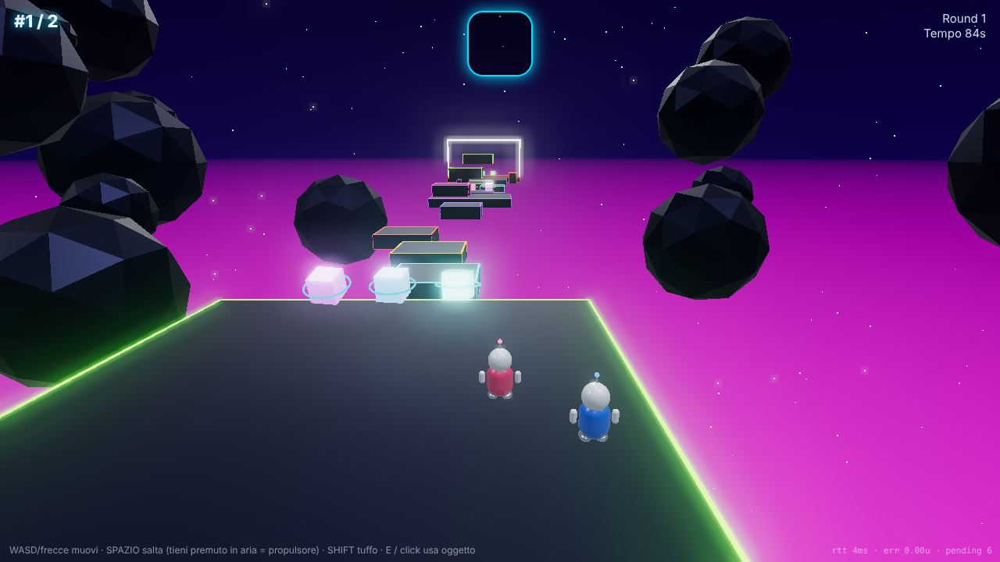

# Cryovanta

Hub di giochi multiplayer **a stanze** (hard cap: **7 client per istanza**), con netcode **server-autoritativo**.
Primo titolo: **Neon Circuit**, platformer a ostacoli competitivo a eliminazione, con casse oggetto, proiettili a ricerca,
boost e trappole rilasciabili.



```bash
npm install
npm run dev:server     # ws://localhost:8080  (+ /healthz)
npm run dev:client     # http://localhost:5173  (apri 2+ schede, "Partita rapida", "Pronto!")
npm test               # 44 test: fisica, impatti, lobby/cap, match completo via rete, ws reali
npm run typecheck
```

Controlli: **WASD/frecce** muovi · **Spazio** salta (premi di nuovo in aria = propulsore) · **Shift** tuffo · **E / click** usa oggetto · tasto destro + mouse: ruota camera.

Architettura, netcode, tabella degli impatti, come aggiungere un gioco: [docs/ARCHITECTURE.md](docs/ARCHITECTURE.md).

| Pacchetto | Contenuto |
|---|---|
| `packages/shared` | Simulazione deterministica (controller, collisioni, oggetti, impatti, round/match), protocollo, predizione client |
| `packages/server` | Hub, stanze (cap 7), loop a timestep fisso 60 Hz, sessione autoritativa di Neon Circuit |
| `packages/client` | Three.js: robot procedurali, piattaforme neon, bloom, input, interpolazione, lobby/HUD |
| `tests` | Vitest: harness in-process a tempo virtuale + test su WebSocket reali |
